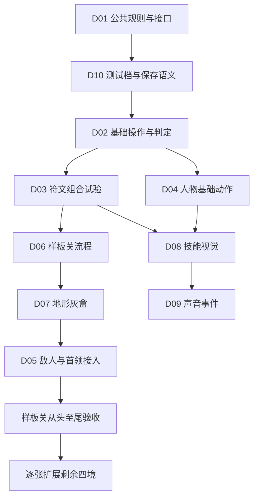

# 《本命剑：八荒五行》可交付初版策划总纲

日期：2026-10-20。性质：未来实施的策划草案；本轮仅生成文档，没有修改运行规则。代码审查基线：`0edf7136246d59c79853dd89dc8a72f5ffbd067c`，`automation/character-art`。不是新的发布版本，不替换既有角色交接和历史设计文档。

实施同步：后续001轮已完成D01的共享旧规则与不可变开战快照切片，见[实施索引](../../implementation/00-实施索引.md)。下文“本轮只读/未执行测试”指策划形成时的记录；当前代码验收以001实际测试和交接为准，不将该切片当作完整新阵盘上线。

## 已确认的产品方向

1. 像素国风横版剑术闯关；五行决定属性风格，八卦决定修行/技能方向，并具有明确的本位五行兼容限制，不继续沿用“各卦任意混配”。
2. 先做一张完整样板关，逐张补齐五境，最终交付五境初版。建议复用基础最完整的火境作为开发样板；这不是规定玩家必须先玩火境。
3. 玩家有推荐的递进路线，已开放的秘境可重玩；不能因为主修或配珠不同而卡死主路。
4. **测试阶段先不永久镶嵌，允许调整配置，重点验证符文式组合。**同属性珠子不能不加区分地线性叠加所有属性。现有代码仍是永久镶嵌，本文是待实施的新方向。
5. 每轮只优化一个大方向，并在其中完成一个可演示、可验收的小目标。不能把一个方向等同于一轮全部做完。
6. 用户追加确认并已选择方案A：完整八卦阵盘，各宫扩展珠位/分支、按本位五行成式，人物境界限制容量。不固定为每方向三珠；剑内星图和分层装配保留为备选创意，不与A同时实施。
7. 各卦技能独立由其核心珠确定元素；全身外观另选主要阵式，不再让全身主副五行覆盖所有技能。拆下关键珠后技能暂时停用，装回恢复。

## 我对当前项目的判断

已经有可运行骨架：账号分档、版本冲突检查、五境配置、基础操作、八卦技能、五行效果、人物 PNG 与独立剑，以及 U01 倒地/结算。应接续这些成果。

距离完整初版主要差在“规则一致、组合有取舍、闯关有递进、反馈看得懂、进度可恢复”。单纯增加人物细节和粒子数量，无法解决这些缺口。

本轮只读核查代码与已有报告，**没有重新执行自动测试**。上一轮 Python 27/Node 44 通过是历史记录，不是本轮的新测试结论。后续按用户追加要求检索了原典、学术研究和博物馆资料；来源和访问限制见 [八卦五行与境界结构备选](12-八卦五行与境界结构备选.md)。没有把原创游戏规则当作古籍记载，也未声称完成商业游戏调研或性能测试。

## 十个独立大方向

| 编号 | 方向与文档 | 解决的问题 | 首个可实施小目标 |
|---|---|---|---|
| D01 | [底层逻辑与公共接口](01-底层逻辑与公共接口.md) | 各模块使用同一套规则、状态和事件 | 明确字段与归属，建立一组共同规则样例 |
| D02 | [基础战斗与操作判定](02-基础战斗与操作判定.md) | 按键、判定、打断、暂停是否可信 | 冻结动作优先级和阶段，补关键交互验收 |
| D03 | [五行珠与八卦成长](03-五行珠与八卦成长.md) | 本位约束、同系成式、境界与成长终点 | 选定完整结构后，先验证一宫的可拆换组合 |
| D04 | [角色与本命剑美术](04-角色与本命剑美术.md) | 同一人物动作完整、武器一致 | 接续 U02 的跳跃/下落腿部姿态 |
| D05 | [敌人与首领](05-敌人与首领.md) | 有预警、有空当、有不同应对方式 | 共享一类近战敌人的完整攻击循环 |
| D06 | [关卡流程与递进](06-关卡流程与递进.md) | 教学、遭遇、检查点、目标与奖励 | 样板关的五段流程灰盒 |
| D07 | [地图地形与场景](07-地图地形与场景.md) | 路线、落点、支路、五境空间差异 | 样板关可通行地形及锚点 |
| D08 | [技能动作与视觉特效](08-技能动作与视觉特效.md) | 施放、命中和五行差异能被看懂 | 一项技能从动作到命中的完整表现 |
| D09 | [音效与声音反馈](09-音效与声音反馈.md) | 战斗信息、力度、氛围 | 单一剑招的挥剑/命中/格挡事件音 |
| D10 | [账号存档与玩家引导](10-账号存档与玩家引导.md) | 配置是否保存、能否恢复、玩家是否理解 | 测试规则集隔离与一次可靠配置保存 |

用户原六项均保留；额外单列接口、战斗判定、敌人行为、账号与引导。测试、文化依据、资源授权、性能预算是所有方向的共同验收要求，不能等到最后才考虑。

## 初版的完成边界

建议初版面向可信、小规模的单机课程展示：

- 五境各一关：固定主路、少量可选支路、一个中途检查点、一名首领；无需随机大世界、复杂寻路和多人实时战斗。
- 单关首次正常体验目标沿用先前讨论的 8–12 分钟，须实际试玩测量；熟练重玩允许更短，不能靠拉长空地凑时长。
- 初次游玩完成一次“战斗→获得珠子→理解组合→关外调整→感受变化→保存→重登恢复”闭环；中期能体验主动技能和一条进阶路线。
- 五行都有明确可用的打法；八卦使用有限技能骨架组合效果，不把每一种珠序都制作成独立技能。境界提供明确阶段，先实现少量阶段，不要求填满完整阵图才算初版。
- 主角身份统一，基础动作完整；招式与怪物威胁可辨，关闭声音或震屏仍能判断战斗。
- 角色三阶段豪华配饰、全部罕见组合、大量新词条、境界长线、交易和公开排行榜不作为初版完成的前提。

## 依赖与推荐实施顺序

完整结构已选A，D03仍要收束节点拓扑、成式和境界口径；下图表示这些产品决定明确后的实施依赖，不表示先写接口再猜玩法。

图中表示依赖，不表示同轮并发改造。实际按一轮一个方向串行推进；人物基础动作在接口稳定后可以独立排入轮次，不必等五张地图都做完。关卡与地图通过灰盒互相校验，不要求先把整个关卡系统或整套场景美术完成。

首批先收束 D03 方案A的节点、境界和成式原则，再依次处理公共接口→测试档/配置保存→基础操作判定→珠子组合试验。之后做一张完整样板关，再逐境扩展。尚未确定的数值不能写死进存档；角色可先做基础动作，再按主要阵式接入元素服装。

## “不影响其他方向”的实际做法

无法承诺模块完全没有依赖；可以做到依赖公开、修改范围受控。

1. 公共规则、动作标识、位置锚点、存档字段只在公共契约中定义一次。
2. 每轮写清允许改什么、读取什么、哪些旧行为必须保持；共享字段改变时先完成一次独立接口任务。
3. 美术、特效、音效读取事件和快照，不能反过来决定伤害或存档。
4. 关卡负责流程；地图负责空间。关卡引用地图锚点，不能复制另一套碰撞逻辑。
5. 新方向先做一条完整链路验证，保留旧路径兼容；渐进拆分 game.js，避免一次改造全部系统。
6. 旧永久规则档与新可拆换测试档隔离；不能为试验直接删除旧存档的保护校验。

实施模板与验收方法见 [11-分轮实施模板与验收](11-分轮实施模板与验收.md)。各文档中的数值、路线和组合样例除明确标注已确认的部分外，均是可调整提案。

## 优先级覆盖说明

本轮用户确认的“可拆换测试、各卦独立元素、完整八卦阵盘A、本位限制、境界容量”优先于旧设计中的永久镶嵌、任意混配、八路三槽、全身主副共用。旧代码仍保留旧规则，尚未实施转换。D03 与专题12给出已选结构及待定细节；不能把目录里的策划文件直接当作已生效配置。
