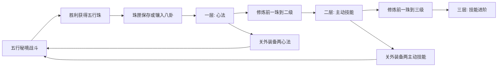
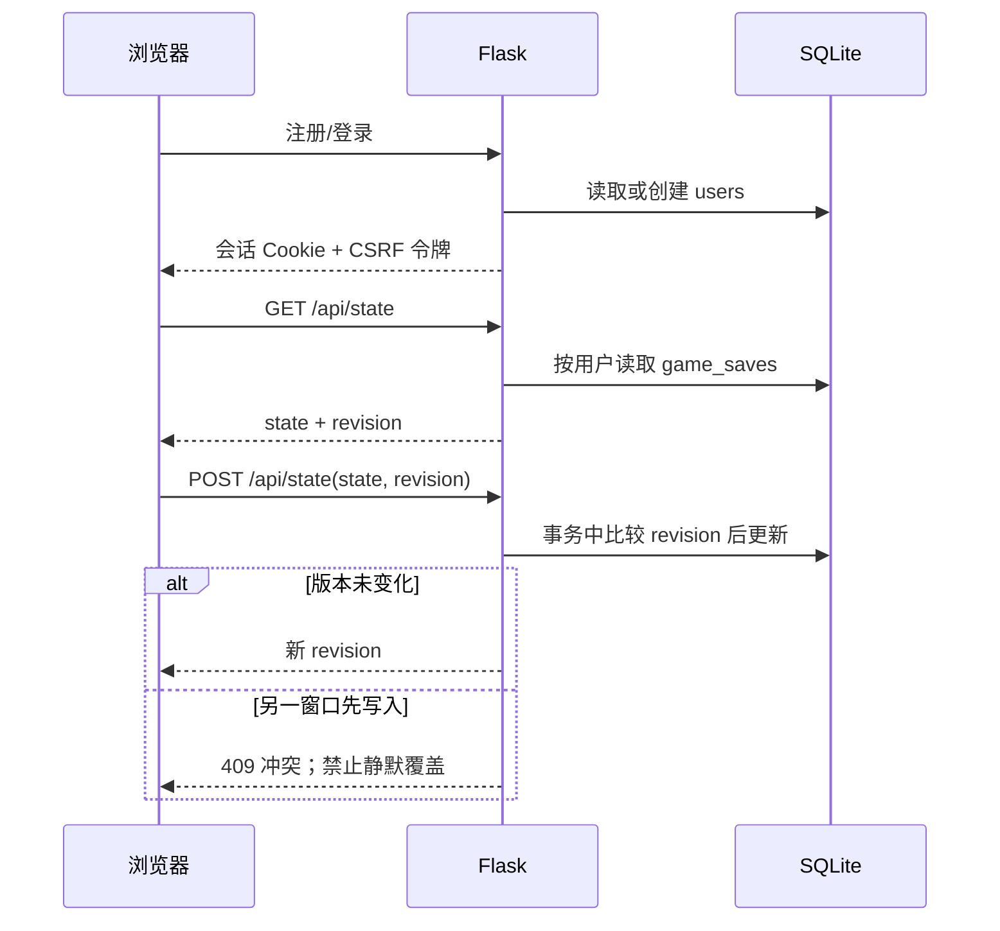

# v0.3.0 八卦修行与五境重构：设计及实际实现

> 状态：`work/v0.3.0-cultivation-worlds` 候选分支，等待人工晚间评测；不是发布说明。本文描述代码现状，不代表后续功能承诺。

## 一、目标与范围

这轮更新沿用横版剑术战斗，把“终身镶珠”与“可换配招”分离：不可逆的是修行经历，可调整的是本次出战配置。五行仍是招式属性，不把任何一卦固定到单一元素。道教与八卦的传统意象用于世界观和技能命名；代码中的数值对应关系属于本游戏设计，并不声称还原古籍中的修炼方法。

本轮目标覆盖账号分离存档、八卦三层成长、八条主动技能、两个技能和两个心法的出战栏、五个关卡的差异化地形与敌人、像素国风角色和技能可视反馈。没有实现联机或后端实时战斗。

## 二、玩法逻辑

每卦 3 个由内向外的固定槽位。第二层镶嵌要求第一层珠子至少 2 级；第三层要求第二层珠子至少 3 级。客户端禁用不合法操作，`game_rules.validate_state()` 也拒绝直接提交的绕过请求。旧存档原本已经镶上的珠子保留，不会因新门槛被拆除。确认镶嵌后，同一珠子的身份、五行、品阶和位置不能改动，等级只能向前增长。品阶影响初始词条数量，五行修为按珠子**当前等级**累计，不再给高品阶永久额外权重；低阶珠升级后可以补足词条数量。

五行负责全身共同的招式倾向：金偏穿透破甲，木偏续航，水偏控制，火偏燃烧爆发，土偏护盾和击退。最高五行与次高五行必须分别明确领先才成为主、副修；并列时显示“未定”，不会偷偷给某属性加成。卦象负责动作方向，装备的心法才提供对应被动；未装备的已学心法不生效。已学主动技能保留在修行图上，但每次仅有 Q、E 两个技能出战。

| 卦路 | 一层心法方向 | 二层主动技能 | 三层进阶效果（当前代码） |
|---|---|---|---|
| 乾 | 剑锋、剑气 | 贯虹剑 | 提高伤害与范围 |
| 坤 | 生命、守御 | 承岳阵 | 护盾吸伤后反击 |
| 震 | 破势、硬直 | 惊雷踏 | 震地范围增大 |
| 巽 | 移动、二段跳 | 穿林步 | 突进更远、伤害更高 |
| 坎 | 剑意、寒滞 | 流泉引 | 牵引范围扩大 |
| 离 | 暴击、爆发 | 照影剑 | 爆发范围扩大、燃烧延长 |
| 艮 | 格挡、护盾 | 止戈式 | 受击化解后追加反击 |
| 兑 | 恢复、续航 | 和息诀 | 恢复更多，并强化下一剑 |

Q、E 各消耗 30 剑意并独立冷却；受击、格挡或其他动作锁定时不能同时施法。主动技能的伤害、粒子颜色和部分附加效果随主修变化。数值尚未做大规模平衡测试。

## 三、五行秘境

五境分别配置前景地板、五处可跳上平台、两处支路祭坛、两处周期性地面危险区和差异化远景轮廓。主路连续通往首领；支路提供可选额外掉落，祭坛还可恢复生命与剑意。木境是林木轮廓、水境有寒潭建筑与蓝调、金境有剑冢矿柱、火境有熔岩宫阙、土境有荒山遗迹。每境目前均为 4 名近战、1 名远程、1 名首领；非火境增加防御、追踪、牵制或重击变体，普通敌人和首领的攻击显示前摇。水境投射物附加短暂减速。实体模型仍由 Canvas 几何像素块绘制，后续可替换资源。

## 四、账号和存档

`users` 新增用户名唯一约束（不区分大小写）、Werkzeug 密码哈希。`game_saves` 保留历史游客 `local` 槽，按 `user:<id>` 分隔账号，并为旧库补充 `revision` 和 `user_id`。已有游客存档可在空账号中手动导入；账号已有存档时拒绝覆盖。登录账号的写入需要会话 CSRF 令牌与匹配的版本号；冲突时前端停用自动保存并提示刷新。客户端备用存档按账号独立键名保存，但冲突后不会自动把备用存档反写到服务器。

这里没有后台角色系统或联机玩法。战斗和掉落仍在浏览器本地计算；后端验证存档结构、珠子身份、镶嵌门槛、出战栏位与并发覆盖，不验证每次战斗的完整轨迹，因此不适合面向陌生玩家开放竞争排行。

## 五、实现对应

| 功能 | 文件 |
|---|---|
| Flask 会话与 API | `app.py` |
| SQLite 表迁移、版本写入 | `database.py` |
| 八卦、不可逆和出战规则 | `game_rules.py` |
| 五境、敌人、技能、角色、前端账号 | `static/js/game.js` |
| 页面与响应式美术 | `templates/index.html`、`static/css/game.css` |
| 规则与交互回归 | `tests/test_auth_and_loadout.py`、`tests/combat.test.cjs` 等 |

下一轮值得优先做：首领阶段与敌人动作帧、关卡支路可读性、技能平衡、前后端统一数据规则，以及测试环境之外的账号安全与服务器权威结算。玩家交易和更大范围地图暂不纳入本轮。
