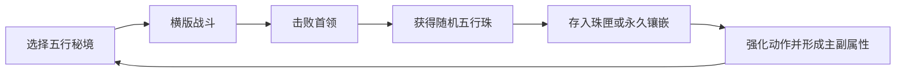

# 《本命剑：八荒五行》第一版设计说明

## 产品定位

项目是一款浏览器运行的像素风横版修仙动作游戏。即时玩法来自移动、跳跃、劈砍、格挡和剑气；长期差异来自五行珠、八卦路线和不可逆的修行选择。

## 核心循环

## 八卦路线

| 卦象 | 方向 | 第三层道法 |
|---|---|---|
| 乾 | 攻势与剑气 | 天剑齐发 |
| 巽 | 身法与移动 | 御风瞬身 |
| 坎 | 控制与剑意 | 玄水剑牢 |
| 艮 | 格挡与护盾 | 山岳不移 |
| 坤 | 守御与生命 | 厚土归元 |
| 震 | 破势与硬直 | 惊雷断岳 |
| 离 | 爆发与暴击 | 离火焚天 |
| 兑 | 恢复与续航 | 泽被万物 |

## 数据保存

浏览器通过 `/api/state` 读取和保存完整单机存档。后端在写入 SQLite 前检查灵珠字段、重复编号、路线层级和历史镶嵌位置。已经存在于修行图中的灵珠不能在后续请求中消失或移动。

## 后续方向

后续版本可以替换正式像素动画、增加地图机关、扩充词条和首领机制，并在不改变当前存档结构的前提下加入轮回角色。
